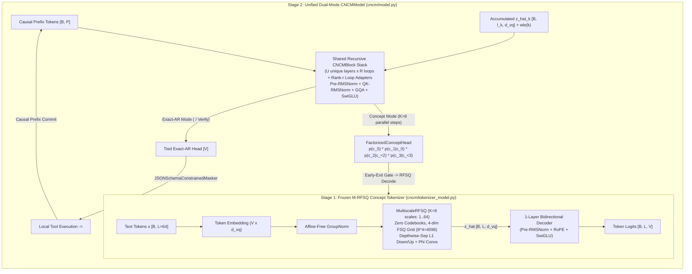
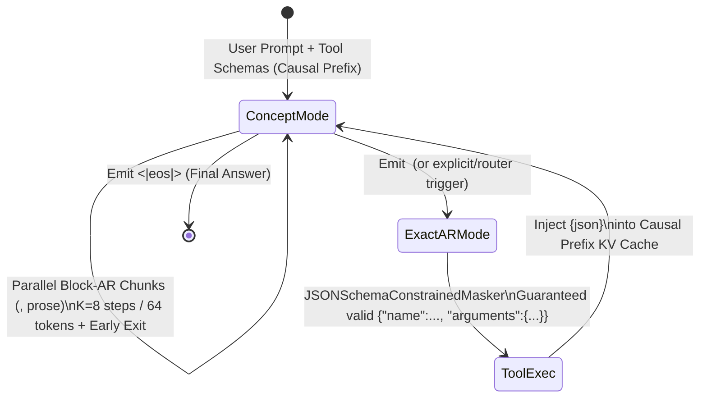

# CNCM Architecture Specification
**Compact Causal-Hybrid Next-Concept Model**

CNCM is a ground-up PyTorch architecture for **fast, memory-efficient, agent-capable text generation on edge devices** (4 GB Android smartphones, 8–16 GB consumer iGPU laptops, Apple Silicon / mobile NPUs, and desktop GPUs). It re-engineers **Next-Concept Modeling** ([HazyResearch/ncm](https://github.com/HazyResearch/ncm), Kumbong et al., *arXiv:2610.14162*) and incorporates compact edge-LLM training lessons from **MiniMind-3**, resolving vanilla NCM's codebook bloat, fixed-window non-causal context limits, and discrete VQ exact-match brittleness for Agentic AI.

---

## 1. Vanilla NCM vs. CNCM: Head-to-Head Comparison

| Dimension | Vanilla `HazyResearch/ncm` | **CNCM (This Repo)** | Edge / Quality Gain (Verified vs. Projected) |
|---|---|---|---|
| **Stage 1 Quantizer** | Multiscale RVQ-VAE with explicit `K × V_code × d_vq` FP32 + EMA codebook tables (e.g., `12 × 4096 × 384 = 18.87M` params, `~151 MB` w/ FP32+EMA buffers); vulnerable to collapse, DDP rank divergence, grad-accum EMA decay bug | **Multiscale Residual FSQ (`MultiscaleRFSQ`)**: zero codebook tables, zero EMA buffers; implicit $8^4 = 4096$-point scalar grid in $d_q = 4$ dims + depthwise-separable cascaded L1 convs & `DepthwiseSepPhi` + affine-free `GroupNorm` | **-18.87M params / -151 MB** eliminated (arithmetic); grad-accum invariant (`max_grad_diff < 5e-7`); ~50.5% mean per-level batch utilization (`99.95%` held-out recon); FP16/BF16/INT8/INT4 quality verified |
| **Chunk & Scale Schedule** | Fixed window $L \in \{128, 1024\}$, $K = 12\text{--}18$ levels, $\sum \ell_k = 641\text{--}11{,}469$ (**5.0×–11.2×** sequence-length blowup); single fixed window without causal chunk chaining | Compact edge chunk $L = 64$, $K = 8$ convex schedule `(1, 2, 4, 8, 12, 20, 36, 64)`, $\sum \ell_k = 147$ (**2.30×** blowup) + **Causal-Prefix Block-AR** across arbitrary-length multi-turn chunks | **2.2×–4.9× lower sequence-length blowup**; unbounded multi-turn context with incremental prefix KV cache |
| **Target Attention & KV Cache** | Bidirectional prefix + `block_diagonal` target scales (single-turn only; no chunk commit) | **Causal prefix** (with optional per-token INT8 KV cache + exact bottom-right causal chunk commit) + **`block_diagonal` target scales** with per-level reset 2D-safe RoPE | **0 MB target-scale KV growth**; exact train/infer parity (`max_abs_diff = 2.7e-7`); INT8 KV drift `ΔNLL = 3e-5` (`100%` top-1 agreement) |
| **Backbone Parameter Efficiency** | Standard non-looped Transformer (`8L–16L`, `768–1024d`, 88M–228M params) | **Relaxed Recursive Layer Looping (`CNCMBlock`)**: Pre-RMSNorm + QK-RMSNorm + GQA + SwiGLU; `num_unique_layers` repeated `num_loops` times with lightweight per-loop RMSNorm + low-rank residual adapters (`rank=16..32`) | **21–24 looped layer passes** (weight-shared) inside `14.5M–93.0M` total params (`12.29 MB` packed INT4 for `nano`) |
| **Concept Output Head** | Flat 4096- or 8192-way softmax head (or `_TiedCodebookHead` distance lookup over large tables) | **Factorized Joint Concept Head (`FactorizedConceptHead`)**: chained autoregressive micro-head predicting $p(c_0)\prod_{j=1}^{d_q-1} p(c_j \mid h, c_{<j})$ over $d_q = 4$ FSQ digits | **71,072 params** (`nano`) / **123,424 params** (`mini`), **~23×–32× fewer output MACs** vs. flat 4096-way head |
| **Agentic Tool Calling & Exact Fidelity** | Pure VQ discrete decoding corrupts strict JSON, numerals (`1956→1957`), identifiers, and code markup even at 99.99% recon accuracy | **Unified Dual-Mode Backbone**: fast parallel Concept Mode for `<think>` & prose + shared **Exact-AR Mode** (`generate_exact` + `JSONSchemaConstrainedMasker`) inside `<tool_call>...</tool_call>` | **100% JSON-schema syntax validity** with zero extra *exact-head* weights (tied to `exact_embed`); semantic argument accuracy requires full-scale SFT |
| **Decoding Acceleration & Verification** | Fixed $K$ steps always; no built-in exact verification | **Dynamic Early-Exit Confidence Gate** (`early_exit_conf`, B=1) in Concept Mode + **Self-Speculative Verification** (`generate_self_speculative`) | **6.4×–8.85× measured Concept-Mode speedup** vs. AR on NVIDIA A10; self-speculative is greedy-equivalent (`exact_greedy_match=True`) but acceptance-dependent (**0.24× / not an accelerator** at short-training scale) |
| **Training & RL Pipeline** | Inference/eval code only (Stage 1 & Stage 2 trainers not released) | Complete pure-PyTorch code: **Stage 1 M-RFSQ**, **Stage 2 Joint Concept + Exact-AR** (`FIMPlanDataset` / `BlockARSFTDataset`, 50% cond corruption, optional self-distill & QAT), and **1-Pass Code-Space GRPO/CISPO** | Complete training code; Stage 3 RL is **experimental** (no measurable reward gain yet at 14.5M / 1.5M tokens) |

---

## 2. System Overview



---

## 3. Detailed Architectural Innovations

### Innovation 1: Multiscale Residual Finite Scalar Quantization (`MultiscaleRFSQ`)
Vanilla NCM stores $K$ separate $V_{\text{code}} \times d_{\text{vq}}$ embedding tables plus FP32 EMA cluster statistics (`ema_cluster_size`, `ema_w`), costing ~151 MB even before Stage 2 weights and breaking under gradient accumulation, multi-rank DDP dead-code restarts, and `.half()` serialization.

CNCM replaces every lookup table with an implicit bounded scalar grid `FSQLevel` (`cncm/quantizer.py`) of shape $(L_0, L_1, \dots, L_{d_q-1})$ (default $(8, 8, 8, 8) \Rightarrow 4096$ implicit codes, $d_q = 4$):

$$h = W_{\text{in}} u + b_{\text{in}} \in \mathbb{R}^{d_q}, \qquad \tilde{c}_j = \frac{L_j - 1}{2} + \frac{L_j}{2}(1 - \varepsilon)\tanh(h_j)$$

$$c_j = \text{clip}\big(\lfloor \tilde{c}_j \rceil,\; 0,\; L_j - 1\big), \qquad \hat{z}_j = \frac{\tilde{c}_j + \text{sg}(\lfloor \tilde{c}_j \rceil - \tilde{c}_j) - \frac{L_j - 1}{2}}{\frac{L_j - 1}{2}} \in [-1, 1]$$

$$u_q = W_{\text{out}} \hat{z} + b_{\text{out}} \in \mathbb{R}^{d_{\text{vq}}}$$

**Residual Multiscale Loop (`k = 0 .. K-1`, scales $\ell_0, \dots, \ell_{K-1}$):**
1. Pre-quantization normalization: affine-free `GroupNorm(num_groups, d_vq, affine=False)` stabilizes residual magnitude without learnable scale drift.
2. Downsample residual $r_k \in \mathbb{R}^{B \times d_{\text{vq}} \times L}$ to length $\ell_k$:
   - Level 0 ($\ell_0 = 1$): learned `DepthwiseSepCascadeDown` (factorized stride-4/3/2 depthwise+pointwise convs initialized to exact average pooling).
   - Levels $k \ge 1$: deterministic area interpolation (`F.interpolate(..., mode="area")`).
3. Quantize via `FSQLevel_k` to obtain digit vector $c^{(k)} \in \{0,\dots,L_j-1\}^{B \times \ell_k \times d_q}$ and continuous quantized embedding $u_q^{(k)}$.
4. Upsample back to length $L$ (`DepthwiseSepCascadeUp` initialized to nearest-repeat for $k=0$; linear/nearest interpolation for $k \ge 1$) and refine via per-level depthwise-separable `DepthwiseSepPhi`:
   $$\Delta \hat{z}_k = (1 - \alpha_\phi) \tilde{u}_q^{(k)} + \alpha_\phi \, \text{PW}(\text{DW}_{3\times 1}(\tilde{u}_q^{(k)}))$$
5. Accumulate $\hat{z} \leftarrow \hat{z} + \Delta \hat{z}_k$ and update residual $r_{k+1} = r_k - \Delta \hat{z}_k$.
6. **Training Loss & Regularizers**:
   $$\mathcal{L}_{\text{Stage 1}} = \mathcal{L}_{\text{CE}}\big(\text{Dec}(\hat{z}_{\text{drop}}),\; x\big) + \beta_{\text{commit}} \sum_{k=0}^{K-1} \text{MSE}\big(z_{\text{norm}},\; \text{sg}(\hat{z}_{\le k})\big)$$
   with **nested dropout (`fine_drop`)** truncating fine levels with probability `fine_drop_prob=0.5` so coarse prefixes $\hat{z}_{\le k}$ remain independently decodable (directly powering dynamic early exit at inference!).

---

### Innovation 2: Compact Edge Schedule, Causal-Prefix Block-AR & Dynamic Early Exit
Vanilla NCM's $L = 128, K = 12$ ($\sum \ell_k = 641$, 5.0× blowup) and $L = 1024$ ($\sum \ell_k = 11{,}469$, 11.2× blowup) create heavy quadratic attention cost and cannot chain chunks with cached prefixes because prefix attention is bidirectional.

CNCM uses an edge-optimized convex scale schedule:
$$\ell = (1, 2, 4, 8, 12, 20, 36, 64), \qquad L = 64, \quad K = 8, \quad \sum_{k=0}^{K-1} \ell_k = 147 \;\; (2.30\times L)$$

**4D Attention Mask Structure (Prefix length $P$, Target concept scales $\ell_0, \dots, \ell_{K-1}$):**

```text
                Prefix (0..P-1)   | L0(1)  L1(2)  L2(4)  ...  L7(64)
Prefix (0..P-1) [ CAUSAL LOWER  ] | [  0     0      0    ...    0   ]
----------------+-----------------+----------------------------------
Level 0 (l_0)   [ FULL PREFIX   ] | [ FULL   0      0    ...    0   ]
Level 1 (l_1)   [ FULL PREFIX   ] | [  0    FULL    0    ...    0   ]
Level 2 (l_2)   [ FULL PREFIX   ] | [  0     0     FULL  ...    0   ]
   ...          [      ...      ] | [ ...   ...    ...   ...   ...  ]
Level 7 (l_7)   [ FULL PREFIX   ] | [  0     0      0    ...   FULL ]
```

- **Causal Prefix + Incremental KV Cache**: Prefix tokens attend causally with monotonic positions `[0 .. P-1]`. After a 64-token concept chunk is decoded, it is committed into the prefix KV cache in **one parallel forward pass** using an exact **bottom-right causal mask** (`k_idx <= P + q_idx`, `is_causal=False`), guaranteeing `< 1e-4` numerical equivalence to uncached full-sequence inference.
- **Zero Target KV Cache Growth**: Target concept scales use **`block_diagonal`** attention with **per-level reset RoPE** (`position_ids = [0 .. l_k - 1]`). Target activations attend to the cached prefix KV and bidirectionally within their own level $\ell_k$, and are immediately discarded before level $k+1$ (which receives the accumulated $\hat{z}_{\le k}$ pooled to length $\ell_{k+1}$).
- **Per-Token INT8 KV Cache (`QuantizedKV`)**: Optional symmetric per-token per-head INT8 key/value quantization halves KV-cache RAM with negligible attention drift.
- **Dynamic Early-Exit Confidence Gate**: At level $k \ge 1$, if the mean max-probability across predicted FSQ digits exceeds `early_exit_conf` (e.g., `0.92`), Concept Mode skips the remaining fine levels and decodes $\hat{z}_{\le k}$ directly via Stage 1's nested-dropout-trained decoder!

---

### Innovation 3: Smarter-Per-Byte Backbone with Relaxed Recursive Layer Looping
Mobile and iGPU models are strictly bounded by parameter RAM and memory bandwidth, yet multi-step reasoning benefits sharply from depth. `CNCMBlock` (`cncm/layers.py`) pairs modern compact transformer blocks (**Pre-RMSNorm + QK-RMSNorm + GQA + SwiGLU**) with **Relaxed Recursive Layer Looping**:

For loop index $r \in \{0, \dots, R-1\}$ and unique layer index $u \in \{0, \dots, U-1\}$:
$$x \leftarrow \text{CNCMBlock}_u(x) + \text{RMSNorm}_{u,r}\!\left(B_{u,r}\big(A_{u,r}(x)\big)\right)$$
where $A_{u,r} \in \mathbb{R}^{H \times \rho}$ and $B_{u,r} \in \mathbb{R}^{\rho \times H}$ ($\rho = 16\text{--}32$, zero-initialized $B_{u,r}$ for smooth identity start) specialize each loop iteration without duplicating the expensive attention and SwiGLU weight matrices.

- **`nano`**: `7` unique layers × `3` loops = **21 effective layers** in **~14.5M unique parameters** (`<15 MB` INT4).
- **`mini`**: `12` unique layers × `2` loops = **24 effective layers** in **~40M unique parameters** (`<30 MB` INT4).
- **`base`**: `12` unique layers × `2` loops = **24 effective layers** in **~93M unique parameters**.
- Optional `BitQuantLinear(nn.Linear)` enables STE fake-quantization-aware training (QAT) while remaining 100% drop-in compatible with `Int4PackedLinear` post-training export.

---

### Innovation 4: Factorized Joint Concept Head (`FactorizedConceptHead`)
Because `MultiscaleRFSQ` encodes every concept token as $d_q = 4$ discrete FSQ digits $(c_0, c_1, c_2, c_3) \in \{0,\dots,7\}^4$, predicting a flat 4096-way logit vector wastes millions of parameters and MACs, while predicting the 4 digits independently ignores cross-digit correlations.

`FactorizedConceptHead` factorizes the exact 4096-way joint distribution via a tiny chained autoregressive micro-head of width $d_h \in [48, 160]$:

$$\log p_\theta(c_0, c_1, c_2, c_3 \mid h) = \sum_{j=0}^{d_q - 1} \log p_\theta\!\left(c_j \;\middle|\; h,\; e_0(c_0), \dots, e_{j-1}(c_{j-1})\right)$$

- **Exact training & RL log-probs**: Teacher-forced in parallel across all $T = \sum \ell_k$ positions in one forward pass — enabling exact 1-pass code-space log-likelihood `compute_code_logprobs` for **GRPO / CISPO**!
- **Tiny footprint**: On `nano` ($H=384, d_h=96, L_j=8$), the entire joint 4096-way head takes **71,072 params** (**123,424 params** on `mini`, vs. $384 \times 4096 = 1.57\text{M}$ for a single flat head, or `18.87M` for per-level untied tables) and **~23×–32× fewer output MACs**.

---

### Innovation 5: Unified Dual-Mode Exact-Action Agentic AI & Self-Speculative Verification
Vanilla NCM's frozen VQ bottleneck introduces rare (~0.01%–1.2%) discrete token flips that catastrophically break strict JSON keys, numeric tool arguments, and code syntax. CNCM resolves this **without adding a second model**:



1. **Joint Stage 2 Training (`forward_joint`)**: Trains the shared recursive backbone simultaneously on Concept Mode (`FactorizedConceptHead` with 50% linear conditioning corruption + level-weighted loss) and Exact-AR Mode (`exact_head`, weight-tied to token embeddings) so both modes stay mutually aligned.
2. **Deterministic Grammar Constraints (`JSONSchemaConstrainedMasker`)**: During Exact-AR tool calls, a token-aware prefix automaton masks invalid next-token logits to $-\infty$, enforcing `{"name": "<registered_tool>", "arguments": {<schema_validated_args>}}</tool_call>` with zero chance of malformed JSON even at 0.5M–15M parameters.
3. **Self-Speculative Decoding (`generate_self_speculative`)**: Drafts a full $L$-token chunk in $K$ parallel Concept Mode steps and verifies all $L$ tokens in **one parallel Exact-AR forward pass** against the exact same backbone, yielding mathematically **lossless greedy equivalence** (`temperature=0.0`) to standard autoregressive decoding. *(Note: actual wall-clock speedup is acceptance-rate dependent; at 14.5M / short-training scale, acceptance is ~0.0 so self-speculative is slower than plain AR—see `CLAIMS.md`.)*

---

### Innovation 6: Plan-Guided Fill-in-the-Middle (PG-FIM) for Code & Prose Infilling
Standard left-to-right concept generation cannot condition on right-side suffix context $S$, while naive PSM infilling in discrete VQ space suffers from unknown middle chunk counts, identifier drift (`total_sum` $\to$ `total_val`), and boundary syntax collisions at the middle-to-suffix seam.

PG-FIM solves all three with a 4-stage dual-mode pipeline on the same unified `CNCMModel`:

```text
<fim_prefix> P <fim_suffix> S <fim_middle>  <mlen_k> <kw> kw_1 | kw_2 | kw_3 </kw>  [ Middle Concept Chunks ] <fim_end>
|------------- Causal Prefix -------------|  |--- Exact-AR Plan (3-10 tokens) ---|  |-- Parallel Concept Mode (K=8) --|
```

1. **11 High-Tail PG-FIM Sentinel Tokens (`[V-11 .. V-1]`) & Edge Context Budgets**:
   - `<fim_prefix>`, `<fim_suffix>`, `<fim_middle>`, `<fim_end>`, `<kw>`, `</kw>`, `<kw/>` (0-keyword escape), and length buckets `<mlen_1>`, `<mlen_2>`, `<mlen_3>`, `<mlen_4+>` (1 to 4+ chunks of 64 tokens).
   - `format_fim_prompt` retains the `fim_prefix_budget=512` tokens of $P$ and `fim_suffix_budget=256` tokens of $S$ **nearest the cursor** (768 tokens total = `8.25 MB` FP16, **`~4.3 MB` under 5 MB with INT8 KV** on `nano`).
2. **Exact-AR Plan Stage with `CodeSymbolTable` & `KeywordPlanMasker`**:
   - `CodeSymbolTable` (`cncm/code/symbols.py`) extracts `defined_identifiers` and `used_identifiers` from $P$ and $S$ via zero-C-binary Python `ast` + lexical recovery (with optional `tree_sitter` and bracket/indent fallback).
   - `KeywordPlanMasker` (`cncm/agent/grammar.py`) hard-enforces `<mlen_k>` at Step 0, `<kw>` or `<kw/>` at Step 1, and $\le 3$ `|`-separated keywords closed by `</kw>`, while applying a **soft symbol-table logit bonus** (`+2.5`) to in-scope identifiers/keywords and a **soft penalty** (`-1.5`, never $-\infty$) to unknown identifiers so new local variables remain expressible.
3. **Parallel Concept Mode Middle Infill + Phase A/B Verification & Copy-Aware Decoding**:
   - **Phase A (Zero New Stage 1 Weights)**: Generates `planned_chunks` chunks in Concept Mode (cutting at `<fim_end>`), then verifies $P + M + S$ via `check_syntax_and_keywords`. If syntax or keyword checks fail, triggers a **1-pass parallel Exact-AR span repair** conditioned on the cached prefix+plan KV.
   - **Phase B (`CopyAwareKeywordCrossAttention`, `cfg.use_copy_decoder=True`)**: Adds a lightweight cross-attention + softplus pointer logit boost in Stage 1 (`cncm/tokenizer_model.py`) over embedded `kw_token_ids` with a zero-initialized residual `copy_gate`, trained self-supervised with automatic oracle keywords and 30% keyword dropout (`copy_kw_drop_prob=0.30`).
4. **Joint Training (`FIMPlanDataset`) & Compiler-in-the-Loop RL (`train_pg_fim_grpo`)**:
   - `FIMPlanDataset` mixes 50% PG-FIM (40% AST-node / 30% line / 30% char spans; 15% `<kw/>` + 15% corrupted keyword + 70% clean oracle keywords) and 50% plain Block-AR, supervising **both** the plan tokens and middle target tokens in `exact_labels`.
   - `train_pg_fim_grpo` & `compute_fim_reward` evaluate $P + M + S$ inside `run_code_sandbox` (`cncm/code/sandbox.py`, AST-audited + tick/timeout-guarded) using an **anti-reward-hacking gated reward table** (`+0.20` parse gated on `non_trivial`, `+0.30` compile gated on `parses`, `+0.50` unit tests gated on `compiles`, `+0.05` keyword faithfulness, `-0.05` length mismatch) and exact joint `compute_pg_fim_logprobs`.

---

## 4. Verified Engineering Pitfalls Explicitly Fixed in CNCM

Every verified source-code bug discovered in `HazyResearch/ncm` and `MiniMind-3` audits is structurally prevented:

1. **2D RoPE Axis-Broadcast Bug**: `apply_rotary_pos_emb` explicitly unsqueezes `cos.unsqueeze(-2)` / `sin.unsqueeze(-2)` on `[B, S, H, D]` layout, preventing silent axis corruption when sequence length `S == num_attention_heads`.
2. **SDPA Top-Left Rectangular Causal Mask Trap**: `F.scaled_dot_product_attention` is always called with `is_causal=False` and explicit 4D additive masks; chunk commits onto cached prefixes of length $P$ use a true bottom-right causal mask (`k_idx <= P + q_idx`).
3. **`.half()` Checkpoint & Buffer Corruption**: Stage 1 M-RFSQ and integer buffers are strictly saved and executed without blind `.half()` casting (`save_checkpoint` preserves exact FP32/INT64 dtypes).
4. **EMA × Grad-Accum & DDP Codebook Divergence**: Eliminated structurally by replacing EMA VQ codebooks with stateless `MultiscaleRFSQ`.
5. **Padding Waste & Omitted Masks**: `PackedChunkDataset` slices contiguous padding-free `L=64` windows; `BlockARSFTDataset` and `train_stage2` always pass explicit `prefix_mask`.
6. **Zero-Warmup LR Instability**: All trainers use `WarmupCosineScheduler` (5–10% linear warmup + cosine decay to `0.1 * lr`).
7. **Backend Portability**: Zero CUDA-only or Triton-only kernels — runs cleanly on CPU, Windows DirectML (iGPU), Apple MPS, CUDA, and exports to ONNX opset 17+.

---

## 5. Presets & Multi-Device Edge Deployment Analysis

### Preset Specifications

| Preset | Vocab $V$ | Chunk $L$ / Levels $K$ | $d_{\text{vq}}$ / FSQ | Backbone $H$ | Unique × Loops (Eff. Depth) | Heads (Q / KV) | Target Tier |
|---|---|---|---|---|---|---|---|
| `tiny_test` | 512 | 16 / 5 `(1..16)` | 48 / `(4,4,4,4)` | 96 | 2 × 2 (**4L**) | 4 / 2 | Fast CPU CI & smoke tests |
| `nano` | 4096 | 64 / 8 `(1..64)` | 128 / `(8,8,8,8)` | 384 | 7 × 3 (**21L**) | 6 / 2 | Low-End Android (4 GB RAM, **<15 MB INT4**) |
| `mini` | 4096 | 64 / 8 `(1..64)` | 192 / `(8,8,8,8)` | 512 | 12 × 2 (**24L**) | 8 / 2 | Consumer iGPU Laptop (8–16 GB RAM, **<30 MB INT4**) |
| `base` | 6400 | 64 / 8 `(1..64)` | 256 / `(8,8,8,8)` | 768 | 12 × 2 (**24L**) | 12 / 3 | Desktop GPU / Apple Silicon / High-End NPU |

### Why CNCM Targets Edge Memory Bandwidth (Projected Roofline vs. Measured A10)

Batch-1 autoregressive decoding is **memory-bandwidth bound**, reading all model weights from LPDDR/DDR RAM **once per generated token** ($64\times$ per 64-token chunk). CNCM's Concept Mode reads weights only **$K = 8$ times** per 64-token chunk (**projected 8.0× HBM/LPDDR bandwidth reduction**; **measured 6.4×–8.85× wall-clock Concept-Mode speedup vs. Exact-AR** on NVIDIA A10 at `B=1`).

> **Important Note on INT4 Latency vs. Footprint:** `quantize_model_int4` reduces `nano` model storage to **`12.29 MB`** (`4.59×` smaller than FP32), but pure-PyTorch dequantization is **memory-only** (~2.25× slower than FP32 on GPU). Edge latency parity requires ONNX QDQ or fused INT4 kernels (e.g., XNNPACK / DirectML / MLX).

### Empirically Measured Footprints & Analytical Roofline Projections

Model sizes and KV sizes below are **empirically measured** from instantiated `CNCMModel` instances (`measure_model_size`, `group_size=32`, INT8 embeddings); the 4 rightmost hardware columns are **analytical roofline projections** (not yet benchmarked on physical Android / iGPU silicon — see [CLAIMS.md](CLAIMS.md)):

| Preset | Total Params (S1 + S2) | FP32 RAM | BF16 Est. | Packed INT8 | Packed INT4 (g=32) | Linear Ratio | KV Cache (1024 ctx, FP16 / INT8) | Low-End Android (INT4) | Consumer iGPU (INT4) | Apple / NPU (INT4) | Desktop GPU (BF16) |
|---|---|---|---|---|---|---|---|---|---|---|---|
| **`tiny_test`** | **0.38M** (`0.10M + 0.28M`) | 1.55 MB | 0.72 MB | 0.62 MB | **0.51 MB** | 5.31× | 0.50 / 0.26 MB | CI / CPU tests | CI / CPU tests | CI / CPU tests | CI / CPU tests |
| **`nano`** | **14.50M** (`1.51M + 12.99M`) | 56.32 MB | 27.65 MB | 17.25 MB | **12.29 MB** (`<15 MB`) | 6.35× | 10.50 / 5.51 MB | **4.27×** vs AR (20.3 MB RAM) | **6.73×** vs AR (20.3 MB RAM) | **7.33×** vs AR | **7.38×** vs AR |
| **`mini`** | **39.33M** (`2.56M + 36.77M`) | 152.04 MB | 75.01 MB | 43.38 MB | **29.67 MB** (`<30 MB`) | 6.38× | 12.00 / 6.30 MB | **3.87×** vs AR (36.6 MB RAM) | **6.56×** vs AR (36.6 MB RAM) | **7.43×** vs AR | **7.50×** vs AR |
| **`base`** | **93.04M** (`5.08M + 87.96M`) | 356.96 MB | 177.47 MB | 98.63 MB | **66.08 MB** | 6.39× | 18.00 / 9.45 MB | **3.47×** vs AR (73.6 MB RAM) | **6.27×** vs AR (73.6 MB RAM) | **7.62×** vs AR | **7.69×** vs AR |

> Reproduce this table live with `python demo_cncm.py --section profile` or inspect full roofline metrics via `cncm.export.profile_edge_targets(cfg, model)`.

---

## 6. `ctx0an` Base vs. Experimental `base_moe` Architecture

- **Main Dense Preset (`base`)**: `93.90M` params (`87.96M` generator + `5.93M` Stage 1 M-RFSQ), `hidden_size=768`, `12` unique layers × `2` recursive loops (`24` effective layers), GQA (`12Q / 3KV`), SwiGLU (`intermediate_size=2304`), `V=6400` Byte-Level BPE (`Digits(individual_digits=True)`), `enc_layers=1` strictly causal Stage 1 encoder, Matryoshka cutoffs `(4, 6, 7, 8)`, Continuous Scaled RoPE, and `L_align`.
- **Experimental MoE Preset (`base_moe`, [experiment/moe_ctx0an.py](experiment/moe_ctx0an.py))**: Replaces dense SwiGLU (`2304`) with `MoEFFN` (`cncm/layers.py`): `1` always-on Shared Expert (`d=768`) + `8` Routed Experts (`d=768`, Top-2 active = `2304` active width) + `24` per-loop routers (`step_moe_routers`) + Switch/DeepSeek load-balancing auxiliary loss (`moe_aux_loss_weight=0.01`) using single-sort sparse dispatch (`argsort` + `bincount`). Total params: `221.45M` (`94.05M` active/token).
- **Controlled Modal A10 A/B Benchmark**: Documented in [BENCHMARK_CTX0AN_MOE.md](BENCHMARK_CTX0AN_MOE.md) and [modal_ctx0an_moe_benchmark.json](modal_ctx0an_moe_benchmark.json) (`base_moe` achieved `-0.1733` Phase 2 Val NLL, `0.9984` load entropy, and `82.85%` Loop 0→1 expert switching).
