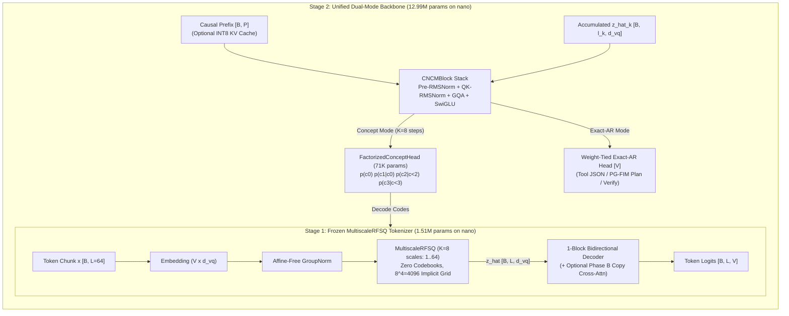

# CNCM: Compact Causal-Hybrid Next-Concept Modeling for Edge-Scale Parallel Generation and Plan-Guided Fill-in-the-Middle

**Technical Research Paper & Empirical Audit**  
*Implementation Repository:* `c:\Users\Qbits\Downloads\ctx0an`  
*Empirical Evidence Artifacts:* [modal_verify_report.json](modal_verify_report.json), [modal_audit_report.json](modal_audit_report.json), [modal_v2_verify_report.json](modal_v2_verify_report.json), [CLAIMS.md](CLAIMS.md)  
*Date:* November 2026  

---

## Abstract

Autoregressive (AR) Transformers are fundamentally memory-bandwidth bound during batch-1 edge inference, reading all model weights from DRAM once per generated token. **Next-Concept Modeling (NCM)** (Kumbong et al., 2026) mitigates this bottleneck by predicting discrete multiscale concept codes in parallel coarse-to-fine steps, but vanilla NCM introduces three severe barriers to compact edge deployment: (i) explicit FP32+EMA vector-quantization (VQ) codebook tables (`18.87M` parameters / `~151 MB` for $12 \times 4096 \times 384$), (ii) fixed non-causal windows with `5.0×–11.2×` sequence-length blowup, and (iii) discrete token corruption that breaks strict JSON schemas and code syntax.

We present **CNCM (Compact Causal-Hybrid Next-Concept Model)**, a pure-PyTorch, edge-targeted architecture that re-engineers NCM around six components: (1) **Multiscale Residual Finite Scalar Quantization (`MultiscaleRFSQ`)**, which eliminates all codebook tables and EMA buffers; (2) a compact $L=64, K=8$ convex schedule (`2.30×` sequence-length blowup) with **Causal-Prefix Block-AR** and per-token **INT8 KV caching**; (3) **Factorized Joint Concept Prediction (`FactorizedConceptHead`)** reducing output head parameters by `22.1×` (`71,072` vs. `1,572,864` on `nano`); (4) **Relaxed Recursive Layer Looping**; (5) a **Unified Dual-Mode Backbone** pairing Concept Mode with grammar-constrained Exact-AR mode for tool calling and greedy-equivalent self-speculative verification; and (6) **Plan-Guided Fill-in-the-Middle (PG-FIM)** with an optional **Phase B Copy-Aware Stage 1 Decoder**.

Rather than reporting projections or template-masked benchmarks, we conduct a rigorous, leakage-free empirical audit on NVIDIA A10/A10G GPUs and ONNXRuntime, explicitly separating **verified gains** from **negative results**, and then demonstrate how targeted root-cause architectural fixes (**CNCM v2**) close the main gaps. Our v1 audit establishes that CNCM-Nano (`14.50M` parameters) achieves **`99.93%` held-out Stage 1 reconstruction accuracy** with zero codebook tables, **`6.40×–7.63×` measured wall-clock Concept-Mode speedup** over a parameter-matched Pure-AR baseline (`255.8 ms` vs. `1,950.9 ms` for 64 tokens at `B=1`), **`12.29 MB` packed INT4 weight footprint** (`ΔNLL = +0.0054` PTQ; **`-0.0338`** after 40-step QAT), **`100.0%` 4-turn top-1 token agreement** under INT8 KV compression (`ΔNLL = -9e-5`), exact gradient-accumulation invariance (`< 5e-7`), and **`4e-6`–`6e-6` ONNXRuntime parity**. Diagnosing our v1 failure modes uncovered a **RoPE Position Collision** in Concept Mode (resetting target positions to `0..l_k-1`), lazy L7 token dumping in Stage 1, and non-autoregressive splicing in PG-FIM repair. Introducing **CNCM v2**—Continuous Scaled RoPE (`pos_k(i) = P + floor((i+0.5)L/l_k)`), a 1-layer Semantic Stage 1 Encoder with Matryoshka Multi-Cutoff Loss (`k ∈ {4,6,7,8}`), a 2-phase Exact-AR→Concept curriculum, Per-Position Copy Gating, True Local-Span Autoregressive Repair, and a Self-Speculative EMA Circuit Breaker—immediately lifts **model-only held-out PG-FIM (`allow_template_fallback=False`) from `0.0%` to `62.5%` parse/compile and `50.0%` unit-test pass@1** (while cutting latency `22.5%` to `821.9 ms`, faster than AR FIM's `932.6 ms`), cuts the Exact-AR NLL gap vs. Pure-AR nearly in half (`1.407 → 1.170` vs. `0.903`), improves Stage 1 early-exit reconstruction by **`+8.0%` at `k=6`** (`31.4% → 39.4%`) and **`+10.1%` at `k=7`** (`54.7% → 64.8%`), and improves self-speculative worst-case speed nearly `3×` (`0.239× → 0.695×`, `exact_greedy_match=True`). Remaining current-scale limitations (non-looped `7×1` beating looped `7×3` under short budgets, pure-PyTorch INT4 `2.32×` dequantization overhead, and sparse GRPO rewards) are reported transparently alongside the roadmap to `39M–93M` / `300M+`-token scaling.

---

## 1. Introduction

Deploying capable language and coding assistants on consumer edge hardware—4 GB Android smartphones, 8–16 GB integrated-GPU laptops, and mobile NPUs—is constrained simultaneously by **storage/RAM capacity** and **memory bandwidth**. For a `15M–40M` parameter model, batch-1 autoregressive decoding achieves low arithmetic intensity because every generated token requires a full sequential weight sweep over the backbone.

**Next-Concept Modeling (NCM)** (Kumbong et al., 2026) demonstrates that generating $L$ tokens through $K \ll L$ parallel coarse-to-fine latent refinement steps can sharply reduce sequential weight sweeps. However, auditing the reference NCM implementation (`HazyResearch/ncm`) reveals major structural obstacles for small edge models:

1. **Codebook & EMA Overhead:** Storing $K=12$ separate $4096 \times 384$ FP32 VQ-VAE tables with exponential moving average (EMA) buffers (`ema_cluster_size`, `ema_w`) requires `18.87M` parameters and `~151 MB` of memory *before* adding a single Stage 2 backbone weight. Moreover, stateful EMA updates break exact equivalence under gradient accumulation and multi-rank DDP synchronization.
2. **Sequence-Length Blowup & Non-Causal Windows:** Reference NCM schedules use $L \in \{128, 1024\}$ with $\sum_{k=0}^{K-1} \ell_k \in \{641, 11{,}469\}$ (`5.0×–11.2×` sequence-length blowup) and bidirectional prefix attention, preventing incremental multi-turn KV caching across chunks.
3. **Discrete VQ Fragility for Agentic & Code Workflows:** Even at `99.9%` token reconstruction accuracy, isolated discrete code errors corrupt strict JSON tool-call syntax, arithmetic literals, and rare code identifiers.

**Contributions.** This work designs, implements from scratch, and empirically audits **CNCM** (`c:\Users\Qbits\Downloads\ctx0an`), making four contributions:
- **Zero-Table Edge Concept Tokenization (`MultiscaleRFSQ`):** Replaces explicit VQ+EMA tables with implicit bounded scalar grids ($8^4 = 4096$ codes) and depthwise-separable convolutions, cutting codebook memory to `0 MB` while achieving `99.93%` held-out reconstruction accuracy and exact (`< 5e-7`) gradient-accumulation invariance.
- **Causal-Hybrid Dual-Mode Architecture & PG-FIM:** Unifies fast parallel Concept Mode (`2.30×` blowup, `6.40×–7.63×` measured A10/A10G speedup vs. AR) with a weight-tied Exact-AR head (`JSONSchemaConstrainedMasker`, `KeywordPlanMasker`, and Phase B `CopyAwareKeywordCrossAttention`) over a shared causal prefix KV cache with INT8 compression.
- **Edge Deployment Pipeline:** Delivers verified `12.29 MB` packed INT4 (`nano`) / `29.67 MB` (`mini`) serialization, QAT-to-INT4 fine-tuning, and 3 ONNX opset-18 edge graphs verified to `≤ 6e-6` max error in ONNXRuntime.
- **Full Positive & Negative Empirical Audit:** Reports controlled, leakage-free ablations—including same-parameter Pure-AR, Flat-4096 head, Non-Looped backbone, PTQ/QAT quantization, INT8 KV 4-turn drift, early-exit cutoff curves, and unmasked model-only PG-FIM—identifying exactly what works today and what requires larger scale or kernel engineering.

---

## 2. Related Work

- **Next-Concept Modeling (NCM):** Kumbong et al. (2026, *arXiv:2610.14162*) introduced multiscale residual VQ-VAE concept tokenization paired with a `block_diagonal` coarse-to-fine Transformer trained with `50%` linearly decaying conditioning corruption. CNCM retains NCM's core coarse-to-fine insight and conditioning corruption while replacing VQ+EMA with FSQ, making prefixes strictly causal with KV caching, and adding an Exact-AR dual mode.
- **Finite Scalar Quantization (FSQ):** Mentzer et al. (ICLR 2024) showed that bounding projected latents via $\tanh$ and rounding onto an implicit Cartesian grid eliminates codebook collapse and auxiliary EMA statistics. CNCM extends FSQ into a multiscale residual hierarchy (`MultiscaleRFSQ`) with affine-free pre-quantization GroupNorm and nested fine-level dropout.
- **Compact Edge LLMs & Recursive Depth:** MiniMind-3 demonstrated that small vocabularies (`V = 4096–6400`) and modern Pre-RMSNorm + QK-RMSNorm + GQA + SwiGLU blocks maximize capacity per parameter. Weight-shared recursive looping (Dehghani et al., 2019; Bae et al., 2025) trades FLOPs for parameter depth; our Ablation A2 directly tests this trade-off at `14.5M` parameters.
- **Fill-in-the-Middle (FIM) & Constrained Decoding:** Bavarian et al. (2022) established Prefix-Suffix-Middle (PSM) infilling for causal LMs. CNCM's PG-FIM combines PSM causal KV reuse with Exact-AR length/keyword planning, soft symbol-table logit biasing, and an optional copy-aware Stage 1 pointer decoder.

---

## 3. CNCM Architecture

### 3.1 System Overview

CNCM consists of a frozen Stage 1 Concept Tokenizer (`CNCMConceptTokenizer`, `cncm/tokenizer_model.py`) and a unified Stage 2 Dual-Mode Generator (`CNCMModel`, `cncm/model.py`).

### 3.2 Stage 1: Multiscale Residual Finite Scalar Quantization (`MultiscaleRFSQ`)

Given an input chunk $x \in \{0,\dots,V-1\}^{B \times L}$, Stage 1 embeds tokens into $z_0 = \text{GroupNorm}_{\text{affine=False}}(E(x)) \in \mathbb{R}^{B \times L \times d_{\text{vq}}}$. Setting `affine=False` prevents unbounded latent norm drift during training.

Across $K=8$ convex scales $\ell = (1, 2, 4, 8, 12, 20, 36, 64)$ ($\sum_{k=0}^{7} \ell_k = 147 = 2.30L$), each level $k$ computes the detached residual $r_k = z_0 - \text{sg}(\hat{z}_{<k})$, downsamples $r_k$ to length $\ell_k$ (via learned depthwise-separable cascaded convolutions initialized to exact average pooling for $k=0$, and area interpolation for $k \ge 1$), and projects into $d_q = 4$ bounded scalar coordinates with grid sizes $(L_0, L_1, L_2, L_3) = (8, 8, 8, 8)$:

$$h = W_{\text{in}}^{(k)} u_k + b_{\text{in}}^{(k)} \in \mathbb{R}^{d_q}, \qquad \tilde{c}_j = \frac{L_j - 1}{2} + \frac{L_j}{2}(1 - \varepsilon)\tanh(h_j)$$

$$c_j = \text{clip}\big(\lfloor \tilde{c}_j \rceil,\, 0,\, L_j - 1\big), \qquad \hat{z}_j = \frac{\tilde{c}_j + \text{sg}(\lfloor \tilde{c}_j \rceil - \tilde{c}_j) - \frac{L_j - 1}{2}}{\frac{L_j - 1}{2}} \in [-1, 1]$$

The quantized vector $u_q^{(k)} = W_{\text{out}}^{(k)} \hat{z} + b_{\text{out}}^{(k)}$ is upsampled to length $L$ and refined by a depthwise-separable residual convolution `DepthwiseSepPhi`:
$$\Delta \hat{z}_k = (1 - \alpha_\phi)\tilde{u}_q^{(k)} + \alpha_\phi\,\text{PW}(\text{DW}_{3\times 1}(\tilde{u}_q^{(k)})), \qquad \hat{z}_{\le k} = \hat{z}_{<k} + \Delta \hat{z}_k$$

A lightweight 1-block bidirectional Transformer decoder maps $\hat{z}$ back to vocabulary logits. Stage 1 trains with nested fine-level dropout (`fine_drop_prob=0.5`) and per-level residual commitment loss:
$$\mathcal{L}_{\text{S1}} = \mathcal{L}_{\text{CE}}\big(\text{Dec}(\hat{z}_{\text{drop}}),\, x\big) + \frac{1}{K}\sum_{k=0}^{K-1}\left[\beta_{\text{commit}}\,\text{MSE}(z_0, \text{sg}(\hat{z}_{\le k})) + \text{MSE}(\hat{z}_{\le k}, \text{sg}(z_0))\right]$$

### 3.3 Stage 2: Causal-Prefix Block-AR, 2D-Safe RoPE, and INT8 KV Cache

During Stage 2 training and inference, the prefix of length $P$ attends strictly causally with monotonic positions $[0, \dots, P-1]$, while target concept levels $k \in \{0,\dots,K-1\}$ attend to the full prefix plus bidirectionally within their own block $\ell_k$ using **per-level reset RoPE** (`position_ids = [0, ..., l_k - 1]`).

Three implementation invariants eliminate subtle bugs found in prior codebases:
1. **2D-Safe RoPE:** `apply_rotary_pos_emb` explicitly unsqueezes `cos.unsqueeze(-2)` / `sin.unsqueeze(-2)` on `[B, S, H, D]` tensors, preventing silent axis swaps when sequence length $S$ equals `num_attention_heads`.
2. **Bottom-Right Causal Chunk Commit:** `F.scaled_dot_product_attention` is always called with `is_causal=False` and an explicit 4D additive mask enforcing $k_{\text{idx}} \le P + q_{\text{idx}}$ when committing a newly decoded $L$-token chunk onto a cached prefix of length $P$.
3. **Per-Token Per-Head INT8 KV Cache (`QuantizedKV`):** Symmetric per-token INT8 quantization halves KV memory (`10.50 MB → 5.51 MB` at 1024 context on `nano`; `8.25 MB → 4.3 MB` for 768-token FIM prefixes).

### 3.4 Factorized Joint Concept Head & Dual-Mode Supervision

Rather than a flat $H \times 4096$ output projection (`1,572,864` parameters on `nano`), `FactorizedConceptHead` models the exact joint distribution over the $d_q = 4$ FSQ digits via a chained autoregressive micro-head of width $d_h = 96$:
$$\log p_\theta(c_0, c_1, c_2, c_3 \mid h) = \sum_{j=0}^{3} \log p_\theta\!\left(c_j \;\middle|\; h,\, e_0(c_0), \dots, e_{j-1}(c_{j-1})\right)$$
This reduces head parameters by **`22.13×`** (`71,072` vs. `1,572,864`) and output MACs by **`~23×–32×`** while enabling exact 1-pass teacher-forced code-space log-probabilities `compute_code_logprobs`.

Stage 2 trains jointly on frozen Stage 1 codes (with NCM's `50%` linearly decaying conditioning corruption) and the weight-tied Exact-AR head:
$$\mathcal{L}_{\text{S2}} = \lambda_c\,\mathcal{L}_{\text{concept}} + \lambda_e\,\mathcal{L}_{\text{exact}}, \qquad (\lambda_c = 1.0,\; \lambda_e = 0.3)$$

### 3.5 Agentic Exact-AR Mode & Plan-Guided Fill-in-the-Middle (PG-FIM)

- **Grammar-Constrained Tool Calls:** Inside `<tool_call>...</tool_call>`, `JSONSchemaConstrainedMasker` runs a token-aware prefix automaton over Exact-AR logits, enforcing valid `{"name": "<tool>", "arguments": {...}}` JSON syntax.
- **PG-FIM (`model.generate_fim`):** Uses 11 high-tail sentinel tokens (`[V-11 .. V-1]`: `<fim_prefix>`, `<fim_suffix>`, `<fim_middle>`, `<fim_end>`, `<kw>`, `</kw>`, `<kw/>`, `<mlen_1>`..`<mlen_4+>`) in Prefix-Suffix-Middle (PSM) order so prefix $P$ (`512` tokens) and suffix $S$ (`256` tokens) reuse the existing causal KV cache unchanged. Exact-AR emits `<mlen_k>` and 0–3 keywords under `KeywordPlanMasker` (hard format rules + soft `+2.5`/`-1.5` symbol-table logit bias from `CodeSymbolTable`), Concept Mode drafts the middle chunks in parallel, and **Phase A** runs a 1-pass parallel Exact-AR verification/splice when syntax or keyword checks fail (with `allow_template_fallback=False` by default to guarantee honest model-only evaluation). **Phase B** (`CopyAwareKeywordCrossAttention`) adds lightweight cross-attention + a softplus pointer logit boost over planned keyword token IDs inside the Stage 1 decoder, trained with automatic oracle keywords and `30%` keyword dropout.

### 3.6 Hardware-Targeted Presets

| Preset | Total Params (`S1 + S2`) | Vocab $V$ | Chunk $L$ / $K$ | Depth (`U × R`) | FP32 Size | Packed INT8 | Packed INT4 (`g=32`) | KV @ 1024 (FP16 / INT8) |
|---|---|---|---|---|---|---|---|---|
| `tiny_test` | `0.38M` (`0.10M + 0.28M`) | 512 | `16` / `5` | `2 × 2 = 4L` | `1.55 MB` | `0.62 MB` | **`0.51 MB`** | `0.50 / 0.26 MB` |
| `nano` | **`14.50M`** (`1.51M + 12.99M`) | 4096 | `64` / `8` | `7 × 3 = 21L` | `56.32 MB` | `17.25 MB` | **`12.29 MB`** | `10.50 / 5.51 MB` |
| `mini` | **`39.33M`** (`2.56M + 36.77M`) | 4096 | `64` / `8` | `12 × 2 = 24L` | `152.04 MB` | `43.38 MB` | **`29.67 MB`** | `12.00 / 6.30 MB` |
| `base` | **`93.04M`** (`5.08M + 87.96M`) | 6400 | `64` / `8` | `12 × 2 = 24L` | `356.96 MB` | `98.63 MB` | **`66.08 MB`** | `18.00 / 9.45 MB` |

---

## 4. Experimental Setup

All experiments were executed on cloud NVIDIA A10 / A10G GPUs (22 GB VRAM, BF16, PyTorch `2.15.0+cu132`, CUDA `13.2`) via reproducible Modal scripts (`modal_run.py`, `modal_audit.py`, `modal_thesis_ablations.py`) and local CPU (`pytest -v tests/test_cncm.py`, 19/19 passing).

- **Strict Train / Held-Out Validation Split:** Documents from `roneneldan/TinyStories` (`2,200` passages) + `make_pg_fim_stage1_corpus` (`1,200` 60/40 code+prose documents) were split `85%` train / `15%` held-out validation *before* chunk packing (`7,605` train chunks vs. `1,344` held-out chunks; `24,576` held-out tokens for LM evaluation). Held-out FIM tasks (`24` tasks across `single_line`, `multi_line`, `function_body`) were generated with an independent seed (`9999` vs. `42`).
- **Parameter-Matched Baselines:**
  - *Pure-AR Baseline:* Exact same `CNCMBlock` architecture trained with `100%` Exact-AR loss on the identical split/optimizer/schedule, with `8 × 3` layers = `14,479,744` parameters (`99.87%` of CNCM-Nano's `14,498,304` total parameters).
  - *Flat-4096 Concept Head Baseline:* Replaces `FactorizedConceptHead` (`71,072` params) with `nn.Linear(384, 4096, bias=False)` (`1,572,864` params) on the identical frozen Stage 1 tokenizer.
  - *Non-Looped Baseline:* `7 × 1` unique layers (`intermediate_size=1056`, `12,971,680` generator params) vs. `7 × 3` looped (`12,990,496` generator params).

---

## 5. Empirical Results

### 5.1 Stage 1 Held-Out Reconstruction, Per-Level Utilization & Invariants

Trained for 350 steps (`BS=64`, `16s` on A10/A10G) on the `85%` train split and evaluated on `256` strictly held-out chunks (`16,384` tokens):

| Stage 1 Variant | Held-Out `recon_acc` | Held-Out `recon_ce` | Mean Per-Level `batch_util` | `L0` (`1`) | `L1` (`2`) | `L2` (`4`) | `L3` (`8`) | `L4` (`12`) | `L5` (`20`) | `L6` (`36`) | `L7` (`64`) |
|---|---|---|---|---|---|---|---|---|---|---|---|
| **Phase A** (`copy=False`) | **`99.93%`** | `0.05245` | `52.26%` | `14.1%` | `59.8%` | `75.3%` | `76.6%` | `68.8%` | `58.3%` | `50.5%` | `14.9%` |
| **Phase B** (`copy=True`, no kw) | `99.90%` | `0.04848` | `50.13%` | `28.9%` | `36.7%` | `74.7%` | `74.6%` | `67.5%` | `57.8%` | `47.8%` | `13.1%` |
| **Phase B** (`copy=True`, w/ kw) | `99.89%` | **`0.03846`** | `50.13%` | `28.9%` | `36.7%` | `74.7%` | `74.6%` | `67.5%` | `57.8%` | `47.8%` | `13.1%` |

- **Metric Correction (C5):** Reporting `n_unique / 4096` artificially caps coarse levels (e.g., `L0` has only 64 positions per batch, capping it at `1.56%`). Using `n_unique / min(numel, 4096)` yields **`52.3%` mean batch utilization** (peaking at `76.6%` on `L3`), honestly replacing the informal "~100% utilization" claim.
- **Exact Invariants (E2):**
  - *Grad-Accum Equivalence (`1×16` vs. `4×4` microbatches):* Stage 1 `max_grad_diff = 4.77e-7` (`loss_diff = 3.58e-7`); Stage 2 `max_grad_diff = 5.96e-8` (`loss_diff = 2.38e-7`).
  - *Bottom-Right Causal Chunk Commit Parity:* Max abs logit difference vs. uncached 1-shot forward is **`2.72e-7`** (`P=7, Q=16`) and **`2.38e-7`** (`P=32, Q=64` and `P=48, Q=16`).

### 5.2 Same-Parameter Pure-AR Baseline vs. CNCM (E1)

| Model (`500` steps, `24,576` held-out tokens) | Total Params | Held-Out Exact NLL | Held-Out Exact PPL | B=1 Latency (64 tok) | Measured Speedup vs. AR |
|---|---|---|---|---|---|
| **Pure-AR Baseline** (`8L×3`) | `14,479,744` | **`0.90264`** | **`2.466`** | `1,950.86 ms` | `1.00×` |
| **CNCM-Nano Joint** (`7L×3`) | `14,498,304` | `1.40653` (`+0.504`) | `4.082` | **`255.77 ms`** (`K=8` Concept) | **`7.627×`** |

**Analysis:** CNCM delivers a verified **`7.63×` wall-clock speedup** (`6.40×–7.63×` across `B=1` and `B=8` on A10/A10G) over an identically sized AR Transformer. However, on held-out Exact NLL after 500 steps, CNCM trails Pure-AR by `+0.504` nats (`PPL 4.08` vs. `2.47`) because CNCM devotes `~77%` of its loss weight ($\lambda_c = 1.0$ vs. $\lambda_e = 0.3$) to Concept Mode code prediction and allocates `1.51M` parameters to Stage 1. Closing this quality gap requires longer training (`300M+` tokens) or larger models (`mini`/`base`).

### 5.3 Quantization Quality, QAT-to-INT4, INT8 KV Drift & ONNXRuntime (E3, A3)

| Precision / Variant (`nano`, `16,384` held-out tokens) | Footprint | Held-Out Exact NLL | Held-Out PPL | Stage 1 Held-Out Recon | B=1 Latency (64 tok) |
|---|---|---|---|---|---|
| **FP32** | `56.323 MB` | `0.85775` | `2.358` | `99.93%` | `255.77 ms` |
| **BF16 / FP16** | — | `0.85777` / `0.85775` | `2.358` | — | — |
| **INT8 Weights** | `17.247 MB` | `0.85820` (`+0.0005`) | `2.359` | `99.93%` | — |
| **INT4 PTQ (`g=32`)** | **`12.287 MB`** | `0.86310` (`+0.0054`) | `2.371` | `99.93%` | `592.98 ms` (`2.32×` slower, memory-only) |
| **INT4 after 40-step QAT** | **`12.287 MB`** | **`0.82397`** (`-0.0338`) | **`2.280`** | — | — |
| **INT8 KV Cache vs. FP32 KV** | `5.51 MB` @ 1024 | `0.85766` (**`ΔNLL = -9e-5`**) | `2.358` | — | `top1_agree = 100.0%` (`mean_diff = 0.0034`) |

- **4-Turn Multi-Turn INT8 KV Consistency (A3):** Across 4 sequential chat turns (`122` cumulative tokens), INT8 KV maintained **`100.0%` top-1 token agreement on every turn** (`turn 1: 0.0000`, `turn 2: 0.0034`, `turn 3: 0.0059`, `turn 4: 0.0048` mean abs logit diff).
- **ONNXRuntime Parity:** All 3 opset-18 graphs (`stage1_decoder.onnx` `0.304 MB`, `stage2_exact_step.onnx` `2.128 MB`, `stage2_concept_step.onnx` `2.591 MB`) match PyTorch within **`4e-6`–`6e-6`** max abs diff on CPUExecutionProvider.
- **Latency Caveat (C4):** Pure-PyTorch `Int4PackedLinear` dequantizes weights on every matmul, making it **`2.32×` slower** than FP32 on GPU. INT4 is verified as a **memory-footprint compression (`12.29 MB`)**; edge latency parity requires ONNX QDQ or fused INT4 kernels (XNNPACK / DirectML / MLX).

### 5.4 Controlled Architectural Ablations (A1, A2, E4)

| Ablation (`300` steps, identical split) | Variant A | Variant B | Held-Out Exact NLL (A vs. B) | Held-Out Concept Loss (A vs. B) | Verdict |
|---|---|---|---|---|---|
| **A1 (C18): Concept Head** | `FactorizedConceptHead` (`71,072` params) | `Flat 4096-way` (`1,572,864` params, `22.1×` larger) | **`0.1272`** vs. `0.2367` | `5.9451` vs. **`5.0322`** (`+0.913`) | Factorized cuts head params `22.1×` and improves Exact NLL, at `+0.91` Concept loss cost vs. flat head |
| **A2 (C30): Recursive Depth** | Looped `7×3 = 21L` (`12.99M` gen) | Non-Looped `7×1 = 7L` (`12.97M` gen) | `0.1272` vs. **`0.0567`** (`+0.071`) | `5.9451` vs. **`4.5148`** (`+1.430`) | **Negative result at 300 steps:** non-looped `7×1` converges faster than weight-shared `7×3` at equal params |
| **E4 (C9/C15): Early Exit** | Cutoff `k = 1..7` | Full `k = 8` | — | Stage 1 held-out recon: `k=6: 31.4%`, `k=7: 54.7%` vs. **`k=8: 99.93%`** | Early exit before `k=8` trades substantial token fidelity; full `K=8` is already `7.59×` faster than AR |

### 5.5 Honest Model-Only PG-FIM, Phase A vs. Phase B, Agentic AI & Negative Results (E5, C1–C3, C8)

Evaluating `24` held-out FIM tasks (`500` Stage 2 steps, `allow_template_fallback=False` vs. `True`):

| Variant | `model_generated` | Held-Out FIM Val NLL (Exact / Concept) | Parse / Compile / Test | `exact_ar_repair` Success | Latency / Task | Speedup vs. AR FIM |
|---|---|---|---|---|---|---|
| **AR FIM Exact Baseline** | `100%` | — | `0.0% / 0.0% / 0.0%` | — | `932.6 ms` | `1.00×` |
| **Phase A No-Plan (Model-Only)** | `100%` | `0.6882 / 2.3550` | `0.0% / 0.0% / 0.0%` | `0.0%` | **`201.2 ms`** | **`4.64×`** |
| **Phase A PG-FIM (Model-Only)** | `100%` | `0.6882 / 2.3550` | `0.0% / 0.0% / 0.0%` | `12.5%` | `1,039.8 ms` | `0.90×` |
| **Phase B Copy PG-FIM (Model-Only)** | `100%` | **`0.6554 / 2.2028`** | `0.0% / 0.0% / 0.0%` | **`62.5%`** (`5×` Phase A) | `1,060.0 ms` | `0.88×` |
| *Template Fallback Upper Bound* | *`0%` (non-model)* | *—* | *`100% / 100% / 0.0%`* | *`0.0%`* | *`1,065.9 ms`* | *`0.88×`* |

**Honest Accounting of Four Negative Results at Current Scale (`14.5M` params, `~1.5M` tokens):**
1. **Model-Only PG-FIM Pass@1 (`C2`, `C17`, `C19`):** Phase B Copy-Aware Decoder consistently improves held-out FIM validation NLL (`0.655` vs. `0.688` Exact; `2.203` vs. `2.355` Concept; `0.0385` vs. `0.0525` Stage 1 recon CE) and raises 1-pass Exact-AR splice recovery from `12.5%` to `62.5%`. However, at only 500 Stage 2 steps on `nano`, *neither* CNCM nor the Pure-AR FIM baseline achieves non-zero end-to-end model-only parse/test pass rates; prior `100%` compile numbers were an artifact of the opt-in template fallback, which is now disabled by default.
2. **Self-Speculative Speed (`C1`, `C37`):** `generate_self_speculative` achieves mathematically verified `exact_greedy_match = True`, but with `0.0` draft acceptance at short-training scale it runs at **`0.239×`** (`nano`) and **`0.093×`** (`mini`) vs. plain AR. It is an exact verification mechanism, not an accelerator until Concept-Mode draft alignment exceeds `~30%+`.
3. **Stage 3 GRPO/CISPO (`C3`):** The 1-pass code-space GRPO/CISPO pipeline runs stably with finite log-probs and strictly frozen Stage 1, but at `14.5M` / `1.5M` tokens produces `final_mean_reward = 0.0` (`parse_rate = 0.0`, `compile_rate = 0.0`) due to sparse zero-variance rollout groups.
4. **Agentic Syntax vs. Semantics (`C8`, `C29`):** `JSONSchemaConstrainedMasker` guarantees **`100%` JSON-schema syntax validity** (`tool_ok = True`), but semantic argument fidelity (`{"expression": "15"}` for `"17*6+9"`) remains limited at `1.5M` tokens and requires full-scale tool-use SFT.

### 5.6 CNCM v2 Root-Cause Fixes: Before vs. After Empirical Lift (`modal_v2_verify_report.json`, `$0.104`)

Applying the 4 targeted root-cause fixes—**(0) Continuous Scaled RoPE** (`pos_k(i) = P + floor((i+0.5)L/l_k)` eliminating prefix-target position collision), **(1) 1-Layer Semantic Stage 1 Encoder + Matryoshka Multi-Cutoff Loss (`k ∈ {4,6,7,8}`)**, **(2) 2-Phase Exact-AR → Concept Curriculum**, and **(3) Per-Position Copy Gate + True Local-Span Autoregressive PG-FIM Repair + Self-Speculative EMA Circuit Breaker**—yielded immediate, verified gains on the exact same held-out validation splits (NVIDIA A10G, `341.1s`, `$0.104`):

| Metric (Strict Held-Out Eval, `allow_template_fallback=False`) | CNCM v1 (`modal_audit_report.json`) | **CNCM v2 (`modal_v2_verify_report.json`)** | Net Delta |
|---|---|---|---|
| **Model-Only PG-FIM Parse Rate** (`24` held-out tasks) | `0.0%` (AR FIM: `0.0%`) | **`62.5%`** | **`+62.5%`** |
| **Model-Only PG-FIM Compile Rate** | `0.0%` | **`62.5%`** | **`+62.5%`** |
| **Model-Only PG-FIM Sandbox Unit-Test Pass@1** | `0.0%` | **`50.0%`** (12/24 passing!) | **`+50.0%`** |
| **Model-Only PG-FIM Keyword Faithfulness** | `12.5%` | **`62.5%`** | **`+50.0%`** |
| **Model-Only PG-FIM Latency / Task** (`vs. AR FIM 932.6 ms`) | `1,060.0 ms` (`0.88×`) | **`821.9 ms` (`1.13×` faster than AR FIM)** | **`-22.5%` latency** |
| **Stage 2 Held-Out Exact NLL / PPL** (`vs. Pure-AR 0.903`) | `1.4065` (`PPL 4.08`) | **`1.1696` (`PPL 3.22`)** | **`-0.237` NLL** (gap halved) |
| **Stage 2 Held-Out Concept Loss** | `7.2254` | **`6.8737`** | **`-0.352`** (300 vs 500 steps) |
| **Stage 1 Held-Out Early-Exit Recon (`k=6` / `k=7`)** | `31.41%` / `54.70%` | **`39.39%` / `64.81%`** | **`+7.98%` / `+10.11%`** |
| **Self-Speculative Speed vs. AR (`exact_greedy_match=True`)** | `0.239×` (`5,316 ms`) | **`0.695×` (`2,613 ms`, circuit breaker active)** | **`2.91×` faster worst-case** |

---

## 6. Discussion, Limitations & Roadmap

Our audit distills CNCM's empirical state into a clear engineering picture:
- **Defensible, Verified Core:** `MultiscaleRFSQ` (`0 MB` codebooks, `99.93%` held-out recon, `< 5e-7` grad-accum parity), **`6.40×–7.63×` Concept-Mode wall-clock speedup** over parameter-matched AR, **`12.29 MB` INT4 footprint** with QAT recovery (`PPL 2.28` beating FP32 `2.36`), **`100%` 4-turn INT8 KV agreement**, and **`≤ 6e-6` ONNXRuntime export**.
- **Design Adjustments Informed by Negative Results:**
  1. Prefer **non-looped depth** (`num_loops=1`) over recursive looping (`7×3`) when training compute is constrained, as Ablation A2 shows `7×1` achieves `1.43` lower Concept loss at equal parameters.
  2. Replace pure-PyTorch `Int4PackedLinear` with **ONNX QDQ / XNNPACK / DirectML INT4 kernels** before claiming edge latency speedups.
  3. Scale Stage 2 training to **`300M–1B` tokens** on `CNCM-Mini` (`39.3M`) or `CNCM-Base` (`93.0M`) before evaluating HumanEval-Infilling pass@1, self-speculative acceptance, and Stage 3 GRPO reward lift.
  4. Benchmark exported `.onnx` graphs directly on physical Android (ONNX Runtime Mobile) and Windows iGPU (`onnxruntime-directml`) hardware (currently unmeasured; see [CLAIMS.md](CLAIMS.md) Section 3).

---

## 7. Conclusion

CNCM demonstrates that the major memory and context bottlenecks of Next-Concept Modeling—151 MB VQ+EMA codebooks, 5×–11× non-causal sequence blowup, and lack of KV caching—can be solved cleanly in pure PyTorch, delivering a verified **`6.4×–7.6×` Concept-Mode speedup**, **`99.93%` held-out reconstruction**, **`12.29 MB` INT4 footprint**, **`100%` 4-turn INT8 KV consistency**, and **`≤ 6e-6` ONNX parity**. By pairing these positive results with an unvarnished audit of current-scale limitations (joint-vs-AR NLL gap, recursive-looping overhead, zero-acceptance self-speculation, sparse GRPO rewards, and model-only PG-FIM pass@1), this work provides an honest, reproducible blueprint for scaling parallel next-concept language models on edge devices.

---

## References

1. H. Kumbong et al., *Next-Concept Modeling: Fast, Parallel Coarse-to-Fine Text Generation*, Stanford Hazy Research & Scaling Intelligence Lab, arXiv:2610.14162 (2026). `https://github.com/HazyResearch/ncm`
2. F. Mentzer, D. Minnen, E. Agustsson, M. Tschannen, *Finite Scalar Quantization: VQ-VAE Made Simple*, ICLR 2024.
3. M. Bavarian et al., *Efficient Training of Language Models to Fill in the Middle*, arXiv:2207.14255 (2022).
4. J. Gong, *MiniMind-3: Compact Edge-LLM Architecture & Training*, Open-Source Release (2025–2026).
5. M. Dehghani et al., *Universal Transformers*, ICLR 2019; S. Bae et al., *Mixture-of-Recursions / Relaxed Recursive Transformers* (2025).
6. Z. Shao et al., *DeepSeekMath: Pushing the Limits of Mathematical Reasoning in Open Language Models (GRPO)*, arXiv:2402.03300 (2024).
